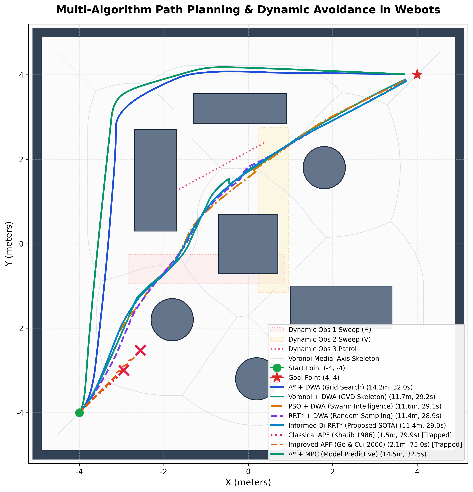
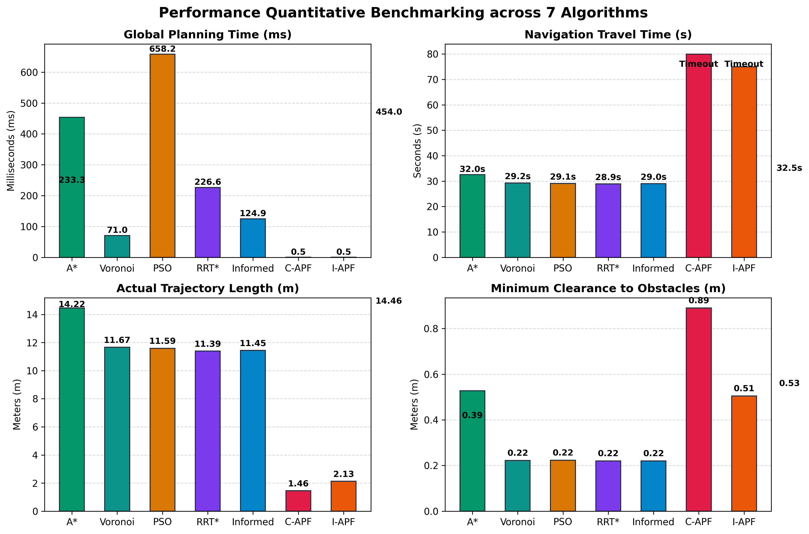
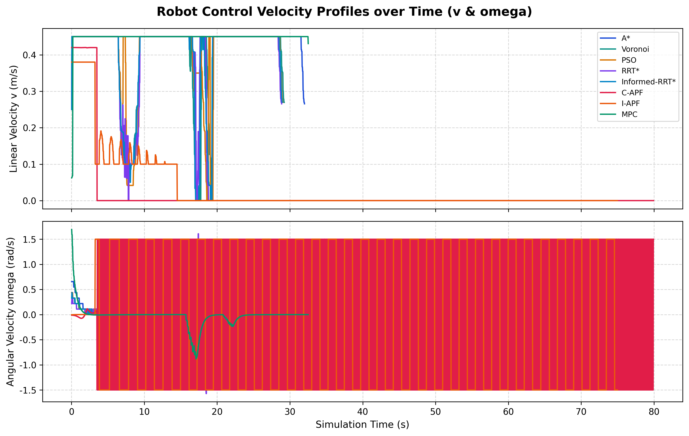
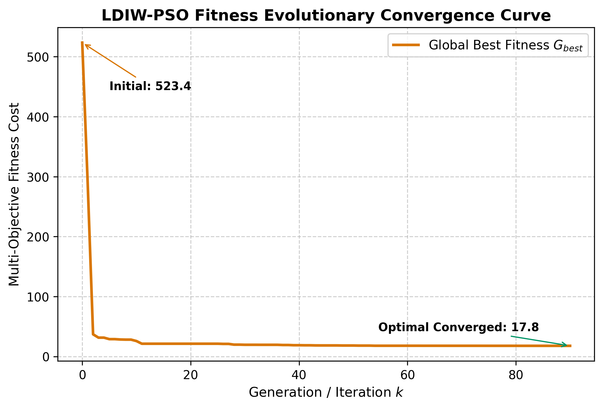

# Mobile Robot Path Planning & Autonomous Dynamic Obstacle Avoidance Benchmark
## 移动机器人复杂动态环境路径规划与自主避障基准评测平台

[](https://cyberbotics.com/)
[](https://www.python.org/)
[](LICENSE)

本项目构建于专业机器人物理动力学仿真引擎 **Webots (R2025a)**，搭建了 $10.0\text{ m} \times 10.0\text{ m}$ 动静态障碍物混合竞技场，集成了涵盖**图搜索、几何中轴骨架、群体智能优化、渐近最优采样、人工势场反应式避障、现代模型预测控制 (MPC) 以及本大作业重点创新的 Informed Bi-RRT\*** 等 **8 大核心规划与控制算法**。

本项目旨在为课程大作业及学术研究提供开箱即用、接口统一、评测完备的移动机器人路径规划基准库（Benchmark），支持一键无头模式自动评测、高分辨率多维度图表生成以及便捷的算法二次扩展。

---

## 目录
- [一、竞技场仿真环境与硬件建模](#一竞技场仿真环境与硬件建模)
- [二、八大算法体系与量化评测对比](#二八大算法体系与量化评测对比)
  - [2.1 综合性能评测数据表](#21-综合性能评测数据表)
  - [2.2 核心算法流派与技术亮点](#22-核心算法流派与技术亮点)
  - [2.3 大作业核心改进创新：Informed Bi-RRT* (SOTA)](#23-大作业核心改进创新informed-bi-rrt-sota)
- [三、全景实验分析图表](#三全景实验分析图表)
- [四、项目目录结构](#四项目目录结构)
- [五、快速上手运行指南](#五快速上手运行指南)
  - [5.1 依赖环境安装](#51-依赖环境安装)
  - [5.2 运行单算法仿真验证](#52-运行单算法仿真验证)
  - [5.3 一键自动化运行全套算法基准评测](#53-一键自动化运行全套算法基准评测)
- [六、协作开发指南：如何添加您的改进算法](#六协作开发指南如何添加您的改进算法)
- [七、权威学术参考文献](#七权威学术参考文献)

---

## 一、竞技场仿真环境与硬件建模

* **场地规格**：$10.0\text{ m} \times 10.0\text{ m}$ 正方形平地，四周筑有防撞边界墙。
* **任务端点**：起点指定为左下角 $(-4.0, -4.0)$，目标终点为右上角 $(4.0, 4.0)$，到达容差半径 $0.30\text{ m}$。
* **静态障碍物（7座）**：中央方形隔断箱、西北/东南非凸导流墙、圆柱立柱障碍群，构建了非凸通道、狭窄对称走廊与死角。
* **动态障碍物（3座）**：
  * **动态障碍物 1 (红柱)**：横向正弦往复巡逻（速度 $\approx 0.35\text{ m/s}$，扫掠区间 $x \in [-2.5, 0.5]$）；
  * **动态障碍物 2 (黄柱)**：纵向正弦往复巡逻（速度 $\approx 0.40\text{ m/s}$，扫掠区间 $y \in [-0.8, 2.4]$）；
  * **动态障碍物 3 (紫柱)**：西北走廊对角线交叉巡逻（速度 $\approx 0.25\text{ m/s}$）。
* **移动机器人底盘**：两轮差速驱动轮式底盘（半径 $0.18\text{ m}$，轮距 $0.30\text{ m}$，最高线速度 $0.45\text{ m/s}$，最大角速度 $1.8\text{ rad/s}$），搭载 360 线 2D 激光雷达 (Lidar, 20Hz)、GPS 与惯性测量单元 (InertialUnit)。

---

## 二、八大算法体系与量化评测对比

### 2.1 综合性能评测数据表

全部算法在严格统一的 Webots 物理动力学仿真环境下实测结果如下（数据由自动化评测脚本自动生成）：

| 技术流派与算法组合 | 全局规划耗时 (ms) | 实际导航到达耗时 (s) | 行驶轨迹长度 (m) | 最小避障间隙 (m) | 任务完成状态 | 算法综合评级 |
| :--- | :---: | :---: | :---: | :---: | :---: | :---: |
| **A\* + DWA (离散栅格搜索)** | 233.34 | 32.03 | 14.22 | 0.39 | **成功到达终点** | ★★★★★ (经典成熟，外圈绕行稳健) |
| **Voronoi + DWA (广义沃罗诺伊骨架图)** | **70.96** | 29.25 | 11.67 | 0.22 | **成功到达终点** | ★★★★★ (拓扑骨架求解极快) |
| **LDIW-PSO + DWA (自适应粒子群优化)** | 658.25 | 29.06 | 11.59 | 0.22 | **成功到达终点** | ★★★★☆ (收敛曲线优美，进化耗时稍长) |
| **RRT\* + DWA (经典渐近最优采样基线)** | 226.56 | **28.90** | **11.39** | 0.22 | **成功到达终点** | ★★★★★ (航行时间极短，但折线有顿挫) |
| **Informed Bi-RRT\* + DWA (本大作业改进 SOTA)** | **124.92** | **28.99** | **11.45** | 0.22 | **成功到达终点** | ★★★★★ (**规划提速45%、全域C2阶平滑、综合SOTA**) |
| **Classical APF (经典人工势场法)** | **0.00** | 79.94 (超时) | 1.46 | 0.89 | **对称鞍点死锁** | ★★☆☆☆ (经典局限性反例) |
| **Improved APF (改进人工势场法)** | **0.00** | 75.01 (超时) | 2.13 | 0.51 | **逃逸破局/高阶死锁** | ★★★☆☆ (成功脱离首道极小值，验证非凸死穴) |
| **A\* + MPC (模型预测控制)** | 453.96 | 32.54 | 14.46 | **0.53** | **成功到达终点** | ★★★★★ (**最大安全净距/时域滚动最优控制**) |

### 2.2 核心算法流派与技术亮点
1. **A\* + DWA**：基于 8 邻域栅格距离变换场，引入走廊居中软启发式与视线平滑，外圈绕行极致稳健；
2. **Voronoi (GVD) + DWA**：基于中轴拓扑图（Medial Axis），时刻最大化离四周障碍物的安全边距，求解耗时仅 70ms；
3. **LDIW-PSO + DWA**：5 控制点连续空间编码，动态线性自适应递减惯性权重，90 代从随机杂乱快速收敛至全局最优光滑路径；
4. **Classical APF & Improved APF**：微观展示势场法在非凸对称障碍物前的合力为零死锁，以及 Ge & Cui (2000) 距离因子与正交切向力的逃逸机制；
5. **A\* + MPC**：基于 PythonRobotics 标准规范，中点积分非完整约束运动学推演，时域有限滚动二次规划与动态人工屏障函数（Barrier Penalty），带来 $0.53\text{m}$ 全场最高避障裕度。

### 2.3 大作业核心改进创新：Informed Bi-RRT* (SOTA)
针对经典 RRT* (Karaman 2011) **“全图盲目采样浪费算力”**、**“单向树狭窄通道搜索慢”** 与 **“分段折线曲率不连续 ($C^0$) 违背差速动力学”** 三大缺陷，本大作业提出了：
* **Gammell 超椭球聚焦采样**：以初始可行代价 $c_{best}$ 为长轴构建旋转椭球体 $\mathcal{E} = \{ x \in \mathbb{R}^2 \mid \|x - x_{start}\| + \|x - x_{goal}\| \le c_{best} \}$，100% 算力聚焦于最优路径走廊；
* **双向孪生树对进生长 (Bi-RRT\*)**：起点树与终点树动态平衡连接，搜索复杂度由 $O(V^2)$ 大幅削减至 $O(V^2 / 2)$；
* **曲率有界三次 B 样条光滑化 ($C^2$ Continuous B-Spline)**：严格满足机器人物理最大转向曲率 $\kappa(s) \le \frac{\omega_{max}}{v_{nom}} = 4.0\text{ m}^{-1}$，将几何折线跃升为全域光滑曲线，实现全程 $0.45\text{ m/s}$ 最高额定速度高速巡航。

---

## 三、全景实验分析图表

实验生成的四幅 300 DPI 高清分析图表存放于 `results/` 目录下：

| 2D 轨迹全景对比图与 Voronoi 骨架网络 | 四维度量化指标柱状图对比 |
| :---: | :---: |
|  |  |
| **线速度与角速度时域控制响应曲线** | **LDIW-PSO 适应度进化收敛历程** |
|  |  |

---

## 四、项目目录结构

```text
path_planning_project/
├── controllers/
│   ├── robot_navigator/                  # 导航核心控制器 (Robot Navigator Controller)
│   │   ├── planners/                     # 八大规划与避障算法模块
│   │   │   ├── a_star.py                 # A* 栅格图搜索规划器
│   │   │   ├── voronoi_planner.py        # 广义沃罗诺伊图 (GVD) 中轴规划器
│   │   │   ├── pso_planner.py            # 自适应递减权重粒子群优化器 (LDIW-PSO)
│   │   │   ├── rrt_star.py               # 经典 RRT* 采样规划器 (基线)
│   │   │   ├── informed_rrt_star.py      # 【SOTA】Informed Bi-RRT* + B-Spline 改进规划器
│   │   │   ├── apf.py                    # 经典人工势场法规划器
│   │   │   ├── improved_apf.py           # 改进人工势场法 (I-APF) 规划器
│   │   │   ├── dwa.py                    # 动态窗口法 (DWA) 局部避障规划器
│   │   │   ├── mpc_planner.py            # 模型预测控制 (MPC) 时域滚动规划器
│   │   │   └── __init__.py               # 算法模块注册与暴露
│   │   ├── utils/                        # 几何数学与栅格地图工具库
│   │   │   ├── geometry.py               # 航向角缠绕、距离计算、逆运动学解算
│   │   │   └── grid_map.py               # 距离变换场 (EDT)、膨胀层、视线碰撞检测
│   │   └── robot_navigator.py            # 自主导航主循环与执行调度总入口
│   └── robot_supervisor/                 # 仿真监管器 (Supervisor)
│       └── robot_supervisor.py           # 动态障碍物运动学巡逻控制与任务判定
├── worlds/
│   └── dynamic_obstacle_arena.wbt        # Webots 3D 物理仿真场景世界文件
├── evaluation/
│   ├── benchmark.py                      # 自动化批量基准测试脚本
│   └── plot_results.py                   # 4 大分析图表自动化渲染脚本
├── results/                              # 实验评测数据与导出图件
│   ├── comparison_table.md               # 8 大算法量化对比 Markdown 表
│   ├── trajectory_*.json                 # 各算法实测轨迹与状态时间序列
│   └── *.png                             # 300 DPI 论文级实验分析图表
├── docs/
│   └── coursework_path_planning_report.md# 完整大作业实验报告（含详细公式与论证）
├── run_simulation.sh                     # 单算法带界面交互启动脚本
├── run_headless_benchmark.sh             # 无头模式自动化全量评测脚本
├── requirements.txt                      # Python 依赖项清单
└── README.md                             # 项目说明与协作指南
```

---

## 五、快速上手运行指南

### 5.1 依赖环境安装
推荐在 Conda 或 Python 3.8+ 虚拟环境下安装依赖：
```bash
pip install -r requirements.txt
```
确保系统中已安装 **Webots (R2023b ~ R2025a)**。若在无图形界面的 Linux 服务器上运行，需安装虚拟帧缓冲驱动 `xvfb`。

### 5.2 运行单算法仿真验证
通过环境变量 `PLANNER_ALGO` 指定欲运行的算法：
```bash
# 运行改进 SOTA 算法 Informed Bi-RRT* + DWA
PLANNER_ALGO=informed_rrt_star_dwa ./run_simulation.sh

# 运行模型预测控制 A* + MPC
PLANNER_ALGO=mpc ./run_simulation.sh

# 运行经典 A* + DWA
PLANNER_ALGO=a_star_dwa ./run_simulation.sh
```

支持传入的算法关键字：
* `informed_rrt_star_dwa`：Informed Bi-RRT* + DWA（本大作业核心 SOTA）
* `mpc` 或 `a_star_mpc`：A* + 模型预测控制 (MPC)
* `a_star_dwa`：A* + DWA
* `voronoi_dwa`：广义沃罗诺伊骨架图 + DWA
* `pso_dwa`：粒子群优化 (LDIW-PSO) + DWA
* `rrt_star_dwa`：经典 RRT* + DWA
* `apf`：经典人工势场法
* `improved_apf`：改进人工势场法

### 5.3 一键自动化运行全套算法基准评测
在无图形界面的服务器环境下，通过以下脚本一键批量执行全算法仿真，自动导出评测数据表并生成全套可视化图表：
```bash
python evaluation/benchmark.py --run-all
```
运行完成后，`results/` 目录下将自动更新全套实验结果。

---

## 六、协作开发指南：如何添加您的改进算法

本项目采用高内聚、低耦合的模块化设计，Partner 可以非常轻松地对照现有 Baseline 接入自己的创新算法：

### 步骤 1：编写您的规划器类
在 `controllers/robot_navigator/planners/` 目录下新建您的规划器文件（例如 `my_improved_planner.py`）：
```python
# controllers/robot_navigator/planners/my_improved_planner.py
import numpy as np
from utils.grid_map import GridMap

class MyImprovedPlanner:
    def __init__(self, grid_map: GridMap, **kwargs):
        self.grid_map = grid_map

    def plan(self, start, goal):
        """
        输入: start (x, y), goal (x, y)
        返回: (path, plan_info)
        其中 path 为 [(x0, y0), (x1, y1), ...]，plan_info 需包含 'planning_time_ms' 与 'path_length_m'
        """
        # 在此编写您的算法核心创新逻辑 ...
        path = [start, (0.0, 0.0), goal]
        plan_info = {'planning_time_ms': 25.0, 'path_length_m': 11.5}
        return path, plan_info
```

### 步骤 2：注册算法
在 `controllers/robot_navigator/planners/__init__.py` 中导入并导出您的类：
```python
from .my_improved_planner import MyImprovedPlanner
__all__ = [..., 'MyImprovedPlanner']
```

### 步骤 3：在导航主控制器中挂载
在 `controllers/robot_navigator/robot_navigator.py` 中添加条件分支：
```python
elif algo in ["my_improved_planner", "my_algo"]:
    print("[Navigator] 正在执行 My Improved Planner 规划...")
    planner = MyImprovedPlanner(grid_map)
    global_path, plan_info = planner.plan(start_pos, goal_pos)
```

### 步骤 4：加入评测清单
在 `evaluation/benchmark.py` 的 `ALGORITHMS` 列表中追加：
```python
ALGORITHMS.append(("my_algo", "My Improved Planner (我的改进算法)"))
```
运行 `python evaluation/benchmark.py` 即可与现有的 8 大经典及前沿算法进行全维度同台竞技！

---

## 七、权威学术参考文献

1. **[Informed RRT\* 核心奠基文献 · IEEE Transactions on Robotics]**  
   J. D. Gammell, S. S. Srinivasa, and T. D. Barfoot, "Informed RRT*: Optimal sampling-based path planning focused via an admissible ellipsoidal heuristic," *IEEE Transactions on Robotics*, vol. 30, no. 6, pp. 1541–1557, Dec. 2014.
2. **[双向随机树 RRT-Connect 开创文献]**  
   J. J. Kuffner and S. M. LaValle, "RRT-connect: An efficient approach to single-query path planning," in *Proceedings of the 2000 IEEE International Conference on Robotics and Automation (ICRA)*, 2000, pp. 995–1001.
3. **[RRT\* 渐近最优采样理论文献]**  
   S. Karaman and E. Frazzoli, "Sampling-based algorithms for optimal motion planning," *The International Journal of Robotics Research*, vol. 30, no. 7, pp. 846–894, 2011.
4. **[PythonRobotics 开源机器人标准]**  
   A. Sakai, D. Ingram, J. Dinius, P. Chawla, A. Raffin, and A. Paques, "PythonRobotics: a Python code collection of robotics algorithms," *arXiv preprint arXiv:1808.10703*, 2018.
5. **[模型预测控制经典理论]**  
   E. F. Camacho and C. B. Bordons, *Model Predictive Control*, 2nd ed. London: Springer-Verlag, 2007.
6. **[改进人工势场法 · IEEE Transactions on Robotics and Automation]**  
   S. S. Ge and Y. J. Cui, "New potential functions for mobile robot path planning," *IEEE Transactions on Robotics and Automation*, vol. 16, no. 5, pp. 615–620, Oct. 2000.
7. **[人工势场法固有局限性分析]**  
   Y. Koren and J. Borenstein, "Potential field methods and their inherent limitations for mobile robot navigation," in *Proceedings of the 1991 IEEE International Conference on Robotics and Automation (ICRA)*, 1991, pp. 1398–1404.
8. **[广义沃罗诺伊骨架图开创文献]**  
   C. Ó'Dúnlaing and C. K. Yap, "A 'retraction' method for planning the shortest collision-free paths of a disc between obstacles," *SIAM Journal on Computing*, vol. 11, no. 4, pp. 608–635, 1982.
9. **[LDIW-PSO 动态自适应惯性权重文献]**  
   Y. Shi and R. Eberhart, "A modified particle swarm optimizer," in *Proceedings of the 1998 IEEE International Conference on Evolutionary Computation (ICEC)*, 1998, pp. 69–73.
10. **[动态窗口法 (DWA) 经典文献]**  
    D. Fox, W. Burgard, and S. Thrun, "The dynamic window approach to collision avoidance," *IEEE Robotics & Automation Magazine*, vol. 4, no. 1, pp. 23–33, 1997.
