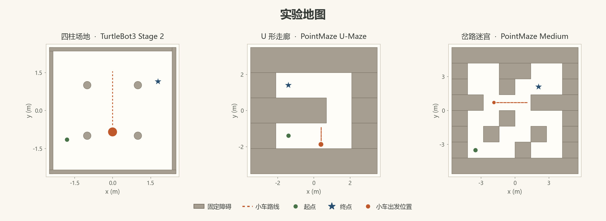
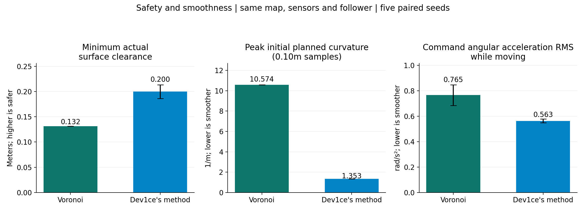
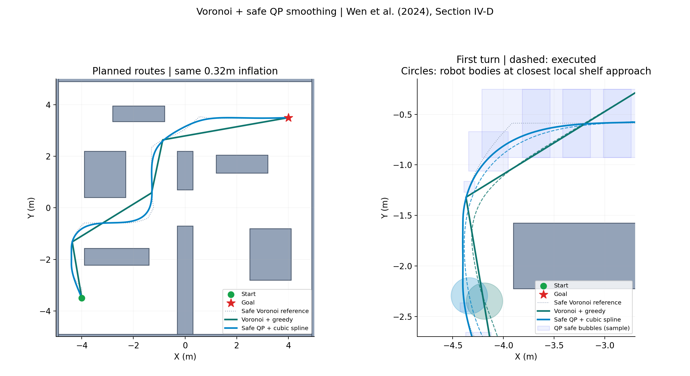
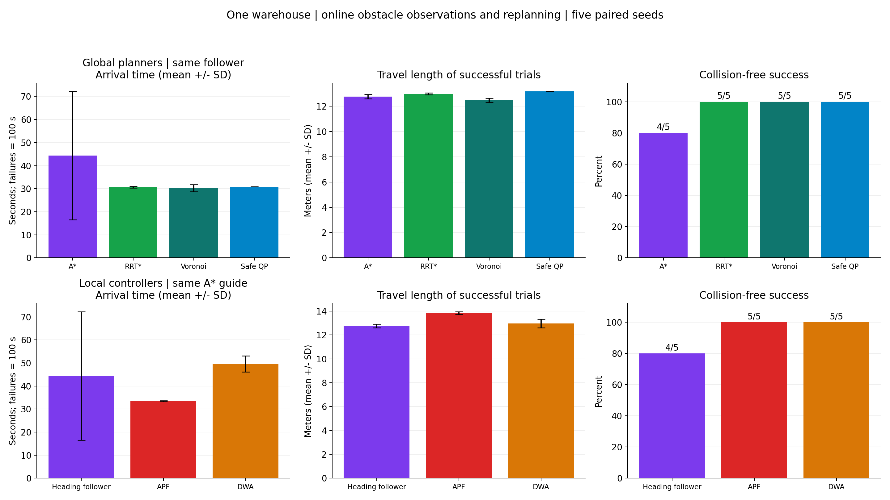
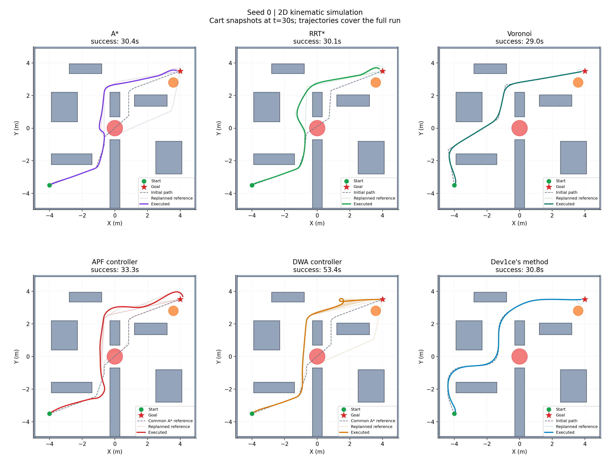

# 机器人避障课设：Voronoi 安全路径平滑

在一张 10 m × 10 m 仓库地图上，对比五个单独的经典算法与 **Voronoi＋安全气泡 QP 平滑**。主要改进目标是安全间距和转弯平顺性。

采用 Wen 等人的 *G²VD Planner: Efficient Motion Planning With Grid-Based Generalized Voronoi Diagrams* 第 IV-D 节的平滑方法，以本项目的 Voronoi 骨架路线作为输入。[论文 DOI](https://doi.org/10.1109/TASE.2024.3398996) · [公开全文](https://arxiv.org/html/2201.12981v4)

普通 Voronoi baseline 的贪心直线简化容易贴近货架拐角。改进方法保留自由空间中部的安全参考路线，在安全气泡内平滑折角，再检查插值路径的可通行性。



| 方法 | 配置值 | 执行方式 |
| --- | --- | --- |
| A* | astar | 栅格搜索，统一跟踪器执行 |
| RRT* | rrt_star | 采样与重连，统一跟踪器执行 |
| Voronoi | voronoi | 骨架搜索、贪心直线简化，统一跟踪器执行 |
| APF | apf | 引力与斥力直接产生控制指令 |
| DWA | dwa | 预测候选速度轨迹并评分，直接朝终点导航 |
| Voronoi＋安全 QP | voronoi_qp | 安全参考、气泡约束 QP、样条插值，统一跟踪器执行 |

四种全局方法共用约 0.64 m 前视距离的跟踪器。APF、DWA 独立运行。机器人尺寸、速度限制、传感器和 0.32 m 障碍膨胀半径相同。

## 实测结果与演示素材

每种方法五个 seed，共 30 次二维运动学实验。seed 改变小车时序的预设偏移，RRT* 同时固定对应采样序列。

| 方法 | 无碰撞到达 | 成功平均耗时 | 成功平均行程 |
| --- | --- | --- | --- |
| A* | 4/5 | 74.38 s | 11.582 m |
| RRT* | 4/5 | 74.78 s | 11.657 m |
| Voronoi | 5/5 | 29.10 s | 12.372 m |
| APF | 0/5 | 5 次超时 | — |
| DWA | 0/5 | 5 次超时 | — |
| 安全 QP | 5/5 | 30.80 s | 13.171 m |

| 安全与平顺性指标（五次平均） | Voronoi | 安全 QP | 变化 |
| --- | --- | --- | --- |
| 每次运行最低实际净空 | 0.132 m | 0.210 m | 增加 60.0% |
| 规划路径峰值曲率，统一 0.10 m 采样 | 10.574 m⁻¹ | 1.353 m⁻¹ | 降低 87.2% |
| 运动中指令角加速度 RMS | 0.630 rad/s² | 0.550 rad/s² | 降低 12.6% |

平均耗时增加 1.70 s，实际行程增加 0.799 m，换取更大的障碍间距和更平缓的转弯。






[1080p 同步视频](results/warehouse.mp4) · [逐次结果](results/summary.csv) · [完整轨迹](results/raw_runs.json.gz) · [方法与答辩说明](docs/coursework_path_planning_report.md)

## 运行

```bash
python -m pip install -r requirements.txt
python scripts/generate_worlds.py
python -m unittest discover -s tests -v
python evaluation/benchmark.py --seeds 0 1 2 3 4
python evaluation/plot_results.py --video
```

二维后端无需 GUI 或 Webots，可以在无显示 Linux 服务器上导出图片；视频导出需要 PATH 中存在 ffmpeg。

安装 Webots R2025a，选用安装了 requirements 的 Python，打开唯一世界文件 `worlds/warehouse.wbt`。默认方法为 `voronoi_qp`，通过 `config.json` 或环境变量 `PLANNER_ALGO` 切换。

```bash
PLANNER_ALGO=voronoi_qp bash run_simulation.sh
python evaluation/webots_benchmark.py
python evaluation/check_webots_smoke.py
```

可用 `WEBOTS_BINARY` 指定原生可执行文件。无显示 Linux 使用 xvfb-run 保留原生雷达渲染。四个 90° 雷达扇区构成 360° 扫描，导航周期 96 ms，Supervisor 每 32 ms 检查实际几何净空。`RECORD_VIDEO=1` 可录制原生视频，运行过程也会导出截图。

## Webots 原生实测

六种方法各运行 seed 0，[完整 CI 与检查记录](https://github.com/Yandick/webots-path-planning-benchmark/actions/runs/43815885972)。
Voronoi 与安全 QP 均无碰撞到达，最低实际净空为 0.13130 m 和 0.20967 m（增加 59.7%），运动中指令角加速度 RMS 为 0.63725 和 0.54613 rad/s²（降低 14.3%）。到达时间为 29.280 s 和 31.168 s。

[原生汇总与溯源](results/webots_validation.json) · [六方法完整原生日志](results/webots_raw_runs.json.gz)


## 内容与依赖

- `navigation/scenarios.py`：唯一地图、小车时序及独立几何净空计算。
- `navigation/grid_map.py`：栅格膨胀与逐格连线碰撞检查。
- `navigation/classical.py`：RRT*、Voronoi、APF。
- `navigation/smoothing.py`：论文安全气泡、QP 目标与样条插值。
- `navigation/core.py`：A*、DWA、统一跟踪器和机器人约束。
- `navigation/metrics.py`：弧长采样、曲率和控制平顺性指标。
- `navigation/tracking.py`：DWA 的连续激光观测速度估计。
- `navigation/settings.py`：方法配置与论文来源。
- `assets/robot.wbo.in`、`scripts/generate_worlds.py`：模型与世界生成。
- `controllers/coursework_*`：Webots 导航和独立评估。
- `evaluation/`：实验、检查与绘图入口。

Python 依赖为 NumPy、SciPy、Matplotlib。QP 使用 SciPy 求解。结果保留汇总、完整压缩轨迹、一次机制消融和演示素材。
