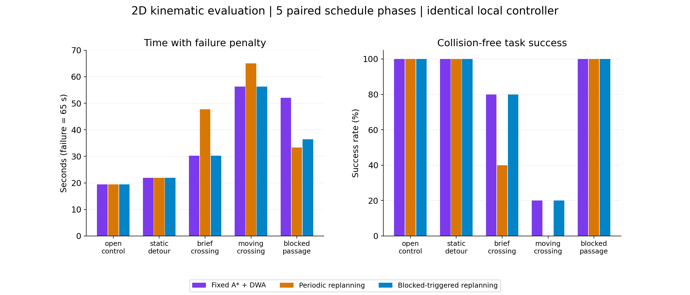
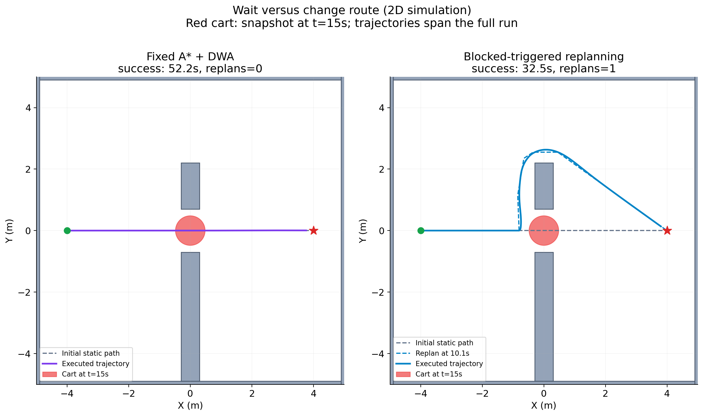

# 机器人避障课设：阻塞触发的 A* 重规划 + DWA

本项目研究一个直观问题：静态地图给出的短路被移动小车长时间堵住时，局部避障为什么一直等待，怎样发现另一条路？

主方法为 **阻塞触发重规划（replan_dwa）**。与固定 A* + DWA 相比，只增加激光观测记忆和停滞触发器，继续使用同一个 A* 和局部 DWA。保留了定时重规划作为比较。旧 Informed Bi-RRT* 代码、原始日志和原世界文件保留用于历史核对；原先的 SOTA、严格曲率约束和零碰撞结论已撤回。

## 目前完成的验证

- 已运行 **二维差速运动学仿真**：5 个场景 × 5 个配对时间偏移 × 3 种方法，共 75 次。
- 持续堵路场景：固定路径平均 **52.04 s**，阻塞触发 **36.44 s**，减少 **29.98%**；两者均 5/5 到达且无几何碰撞。
- 定时重规划在该场景平均 **33.30 s**，共重规划 32 次；阻塞触发共 4 次。事件触发减少计算次数，但并非最快。
- 短暂横穿和快速横穿仍有碰撞，完整保留。方法解决的是持久阻塞后的路线切换，不具备运动预测能力。
- **Webots 适配器和世界已生成**，原生物理运行结果单独存储在 `results/webots/`，不把二维数字写成 Webots 实测。GitHub Actions 另设原生 Webots 控制器检查，实际状态以 Actions 日志为准。




[同步障碍物运动的二维演示视频](results/revised/blocked_passage.mp4) · [完整实验说明和答辩要点](docs/coursework_path_planning_report.md)

## 运行二维实验，不需要 GUI 或 Webots

```bash
python -m pip install -r requirements.txt
python -m unittest discover -s tests -v
python evaluation/benchmark.py --seeds 0 1 2 3 4
python evaluation/plot_revised.py --video
```

`--video` 需要 PATH 中有 ffmpeg；不导出视频时去掉该参数即可。

数据包括 `results/revised/summary.csv`、限定本次运行范围的 `manifest.json`，以及无损压缩的全部 75 次轨迹 `raw_runs.json.gz`。压缩包是 JSON 字典，以原始日志文件名为键，包含每步障碍位置、控制指令、净空和所有重新规划路径。绘图脚本可以直接从压缩包读取。新实验生成的未压缩逐次日志不会加入 Git。

## 五个场景

| 场景 | 用途 |
| --- | --- |
| open_control | 没有动态小车，检查新机制是否引入无谓动作 |
| static_detour | 必须绕静态墙，检查地图、膨胀和跟踪一致性 |
| brief_crossing | 临时横穿，检查短时间等待是否比重新找路合适 |
| moving_crossing | 较快来回横穿，暴露缺少运动预测的局限 |
| blocked_passage | 小车进入窄口停留，再离开；检查是否切换上方绕行通道 |

动态场景的 seed 仅改变事先确定的动作时间偏移，所有方法使用完全相同的时间表。静态场景不同 seed 的几何相同，重复记录不代表五张随机地图。

## 运行 Webots

安装与系统匹配的 Webots R2025a，在 Webots Python 设置中选择安装了依赖的 Python。Windows 不能直接运行随目录拷贝的 Linux Webots。

打开 `worlds/blocked_passage.wbt`，默认运行 `replan_dwa`。修改 `config.json` 为 `fixed_dwa` 后重新加载仿真，即可对比；环境变量 `PLANNER_ALGO` 优先于配置文件。

Linux 交互与批量运行：

```bash
# 如有需要，先 export WEBOTS_HOME=/path/to/webots
PLANNER_ALGO=replan_dwa SCENE=blocked_passage bash run_simulation.sh
python evaluation/webots_benchmark.py --scenes open_control blocked_passage --methods fixed_dwa replan_dwa
```

Windows 可将 `WEBOTS_BINARY` 设置为本机 Webots 可执行文件路径，再运行同一 Python 批量脚本。无显示 Linux 需要 xvfb-run，并保持渲染开启以获得激光观测。环境变量 `RECORD_VIDEO=1` 可启用 Supervisor 录制。

每次 Webots 运行使用独立 RUN_ID，必须同时产生导航器和 Supervisor 新日志，并校验算法名称与场景摘要；旧文件不会被当作新结果。

## 方法与公平比较

`navigation/core.py` 实现三个方法：

- `fixed_dwa`：仅初始化一次静态 A* 路径，随后 DWA 局部避障。
- `periodic_dwa`：检测到地图外观测后，按 4 s 冷却周期重规划。
- `replan_dwa`：约 2.5 s 内位置净移动不足 0.18 m、存在额外障碍观测且冷却结束时重规划。

新增点来自当前激光表面点与已知静态地图的差异，量化到 0.15 m 单元，保存 4 s 后过期。重规划失败时保留原路径并记录尝试。没有将动态小车的未来时间表、真实中心和半径提供给规划计算。

三者共享相同的 0.45 m/s 速度限制、轮速限制、1.5 s 预测时域、加速度约束、360° 感知、碰撞阈值、静态地图和评价函数。这里的固定路径 baseline 是新版共享控制器，不是旧仓库 DWA 数据的重复评测。

## 地图和碰撞统计

唯一场景定义在 `navigation/scenarios.py`，Webots 世界由 `scripts/generate_worlds.py` 生成，二维仿真也读取同一份定义。动态小车是显式声明的预定运动学演员，运动不读取机器人位置；生成前检查其完整时间表不与静态几何相交。它们仍是脚本模型，不是具备感知、决策的行人或车辆。

二维仿真使用有遮挡的解析激光与 10 ms 子步几何碰撞检查。净空是**机器人表面到障碍表面的距离**，允许出现负值；碰撞立即记为失败。Webots 由独立 Supervisor 使用实际机器人位置计算几何净空，每 32 ms 检查一次，另存真实障碍位置和最终状态。它没有被宣称为经过连续碰撞证明的安全控制器。

原场景的核对见 `results/revised/legacy_audit.json`，可运行 `python evaluation/audit_legacy_scene.py` 重现。

## 目录

- `navigation/`：共享场景、A*、DWA、触发器、二维仿真。
- `controllers/coursework_*`：Webots 传感器/电机适配与独立评测。
- `controllers/robot_*`：旧实现，保留作历史对照。
- `worlds/*.wbt`：新场景；`legacy_arena.wbt` 是原始地图。
- `evaluation/revised_benchmark.py`、`plot_revised.py`：配对实验和可视化。
- `evaluation/webots_benchmark.py`：原生 Webots 实验入口。
- `tests/`：关键几何、感知、控制和地图一致性检查。

## 参考资料

- Fox, Burgard, Thrun. The Dynamic Window Approach to Collision Avoidance, 1997. [原论文](https://publications.ri.cmu.edu/storage/publications/pub_files/pub1/fox_dieter_1997_1/fox_dieter_1997_1.pdf)
- Fox et al. A Hybrid Approach to Collision Avoidance, 1998. [作者页面](https://rse-lab.cs.washington.edu/abstracts/obstserver-icra98.abstract.html)
- [Webots 官方 Supervisor API](https://github.com/cyberbotics/webots/blob/R2025a/docs/reference/supervisor.md)

贡献定位是课程项目中的机制实现与对照分析，不宣称提出了新的 A*、DWA 理论或达到 SOTA。
