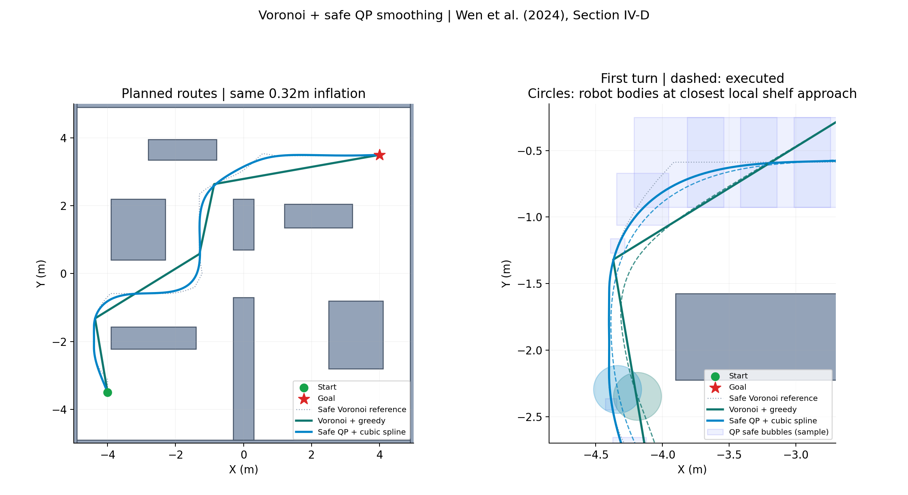
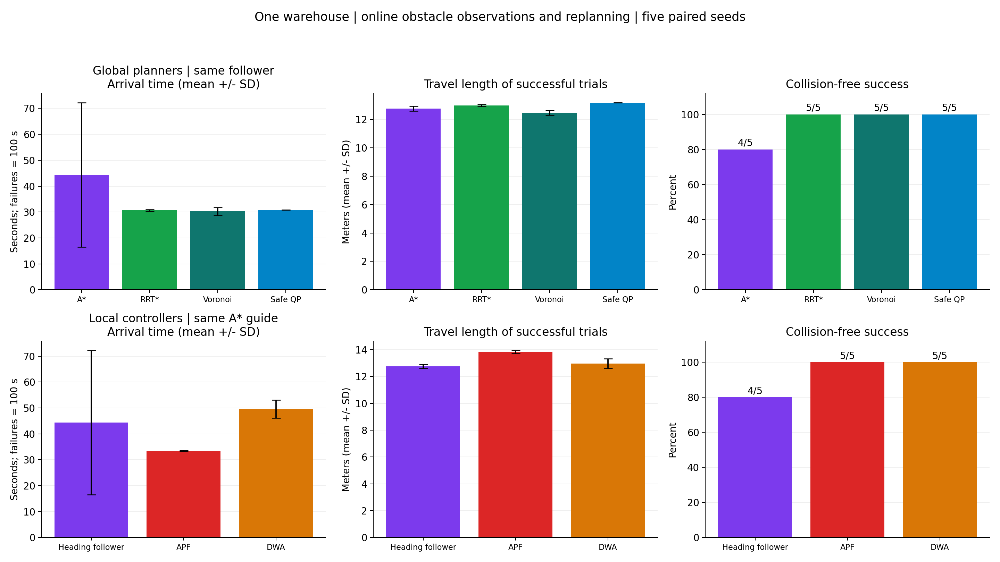
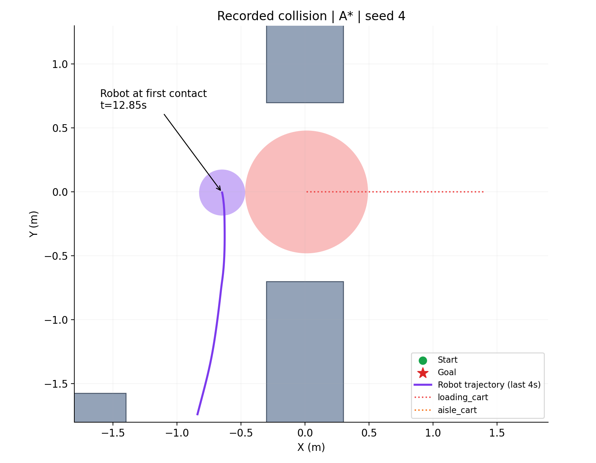
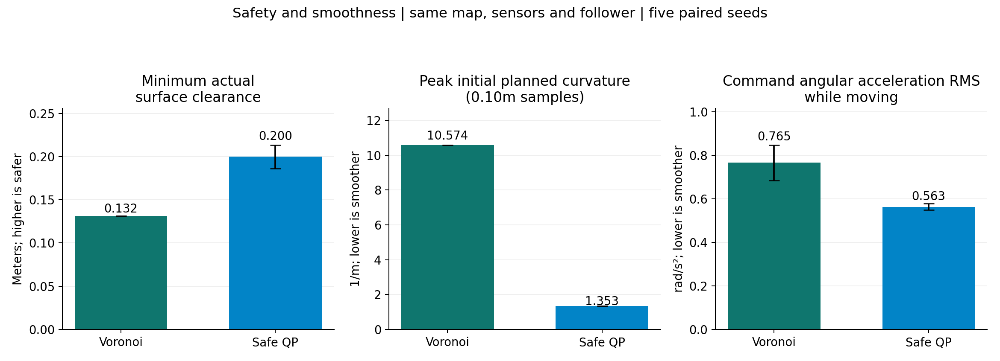

# 在线机器人避障：基准修复、安全路径平滑与实验结果

## 1. 研究对象与分组

唯一地图为 10 m × 10 m 仓库，起点 (-4,-3.5)、终点 (4,3.5)，包含七组货架、中央通道、上方通道和两辆运动小车。装卸车在 seed 0 的 t=12..58 s 占用中央通道；巡行车经过上方出货区。小车时序预先给定，不读取机器人或算法身份。

全局规划组比较 **A*、RRT*、Voronoi、安全 QP**，使用同一个方向跟踪器。局部控制组比较 **方向跟踪器、APF、DWA**，使用共同的 A* 引导与重规划机制。方向跟踪器的记录来自 A* 运行，因此六种方法共 30 次运行即可构成两组比较。

APF、DWA 的结果代表带共同参考路线的局部控制表现。配置、角色和参考规划器均写入每次日志的 `role`、`guide_planner` 字段。

## 2. 共同感知、动态地图与执行约束

物理场景只有墙、货架和两辆小车。激光点是表面测量，观测占据栅格是这些测量的地图表示。

动态层参考 [Nav2 障碍层的标记与射线清除方式](https://docs.nav2.org/jazzy/configuration_and_development/configuration_guide/core_servers/costmap_2d/costmap_plugins/obstacle/)：测量射线清除旧动态占据，命中点标记占据，观测最长保留 1 s。已知静态地图参与障碍分类；所有原始命中点仍交给局部控制与制动层。

每个控制步更新观测并检查剩余路线。发现新堵塞后重复调用相应全局规划器；规划尝试之间至少间隔 1 s。没有执行规划的检查不会推迟下一次触发。所有方法应用同一规则。

机器人半径 0.18 m，静态及动态规划膨胀半径 0.32 m。最大线速度 0.45 m/s、角速度 1.5 rad/s，线加速度 0.8 m/s²、角加速度 3 rad/s²；轮距 0.30 m，左右轮线速度上限 0.50 m/s。公共跟踪器按 0.08 m 弧长重采样，使用 8 个间隔的前视点。

障碍运动或跟踪误差可能使机器人进入规划余量区。此时可通过半径加 0.03 m 检查的连接段离开；共同制动层也允许物理净空安全、间距增加的脱离动作。整个过程保留占据单元，不删除障碍。DWA 的候选筛选采用相同的余量区脱离规则。

导航代码只读取位姿、实际速度、静态地图和当前扫描。小车真实位置、半径和时序由独立仿真器用于物理评估。

## 3. 四个 baseline 的实现与修复

### A*

依据 Hart、Nilsson、Raphael 的 [A* 原始工作](https://doi.org/10.1109/TSSC.1968.300136)，在 0.10 m 栅格上进行八邻域搜索，禁止穿角，并进行连线检查和直线简化。检测到动态堵塞后，从当前位姿在更新后的占据图上重新搜索。

### RRT*

依据 Karaman、Frazzoli 的 [RRT* 工作](https://arxiv.org/abs/1105.1186)，采用父节点选择、重连及子树代价更新。每次规划 1800 次采样，步长 0.4 m，目标采样率 15%。每个 seed 及规划尝试使用确定的随机序列。动态堵塞后重新构建树，失败尝试记录在日志中。

### APF 局部控制

依据 [Khatib 的人工势场与耗散反馈](https://khatib.stanford.edu/publications/pdfs/Khatib_1986_IJRR.pdf)，采用目标引力、最近测量表面的斥力及速度阻尼；最近障碍势能的使用也可参见 [PythonRobotics APF](https://github.com/AtsushiSakai/PythonRobotics/blob/master/PathPlanning/PotentialFieldPlanning/potential_field_planning.py)。

以参考路线前视点为局部目标。引力系数 2，阻尼系数 2，斥力系数 0.008，斥力作用距离 0.50 m。将合力减去速度阻尼后积分为期望世界速度，再转换成差速机器人的线速度和朝向控制。合力减弱时，前进速度随之减小。

这修正了仅取合力方向、在抵消附近仍保持明显前进速度的问题。机器人约束和最终制动由共同执行层处理。

### DWA 局部控制

依据 [Fox、Burgard、Thrun 的 DWA](https://publications.ri.cmu.edu/storage/publications/pub_files/pub1/fox_dieter_1997_1/fox_dieter_1997_1.pdf)，在实际速度及加速度允许的窗口内采样 7×31 组线速度、角速度。参考路线提供局部目标，预测视野 1.7 s。

对圆形机器人与测量命中点的膨胀圆盘，计算连续直线/圆弧上的首次接触距离，再检查是否有足够的反应与制动距离。三个评分项统一归一化：

\[
G(v,\omega)=0.60h+0.25d+0.15s,
\]

其中 \(h=1-|e_\theta|/\pi\)，\(d\) 是首次接触距离除以 1 m 后截断到 [0,1] 的值，\(s=v/v_{max}\)。1 m 截断仅用于评分，安全判断使用实际接触距离。

上述参数是本项目差速平台与激光输入的配置。当前 DWA 使用可达速度窗、连续圆弧安全检查与归一化三项评分，并使用共同 A* 路线目标；删除了原先额外的转向变化惩罚、未归一化评分和自定义障碍速度预测。

## 4. 安全 QP 方法及改进动机

采用 Wen 等人的 **G²VD Planner: Efficient Motion Planning With Grid-Based Generalized Voronoi Diagrams**，2024 年在线发表。[DOI](https://doi.org/10.1109/TASE.2024.3398996) · [全文](https://arxiv.org/html/2201.12981v4)

Voronoi baseline 沿骨架搜索后进行贪心直线简化。其路线较短，但在拐角处可能压缩障碍间距。安全 QP 保留中间参考路线，在安全气泡内平滑折角，目标是障碍间距与运动平顺性。

复现论文 IV-D、式 (5)–(8) 的平滑模块，以几何 Voronoi 路线作为输入：

1. 按 0.10 m 弧长采样参考路线。
2. 用障碍距离为每个参考点建立正方形安全气泡，固定起终点。
3. 求解带盒约束的二次优化，减少折角并限制偏离安全参考线。
4. 采用三次样条，按 0.04 m 间隔离散并检查每条线段。若插值不通行，使用检查通过的 QP 折线；两者均不通行则记录规划失败。
5. 交给相同跟踪器，并使用相同的动态重规划规则。

\[
\min_{p_i}\quad w_s\sum_i\|p_{i+1}-2p_i+p_{i-1}\|^2+w_r\sum_i\|p_i-r_i\|^2.
\]

第一项平滑折角，第二项保留安全参考路线。气泡半宽依据论文为

\[
b_i=\max\left(0,\frac{d_i}{\sqrt2}-0.32\right).
\]

栅格距离减去半个栅格对角线后用于气泡边界。使用 SciPy L-BFGS-B 求解，固定平滑/参考权重 1000/1；论文原实验为 10/1。



## 5. 实验协议与指标

唯一地图，六种方法，每种五个时序 seed，共 30 次。seed 0 无时序偏移，其余 seed 使用 [-1,1] s 内预先给定的小车动作时间偏移；所有报告运行采用同一套固定配置。

二维后端使用 180 条射线的 360° 首交点扫描，最远 5 m，包含遮挡。控制周期 0.10 s，物理净空每 0.01 s 检查。100 s 内进入终点 0.25 m 范围且此前无碰撞计为到达；首次碰撞即终止。

- 最低实际净空是每次运行中，机器人外轮廓到任一真实障碍表面的最小距离；安全表对全部五次取平均，包含失败记录。
- 初始路径峰值曲率按统一 0.10 m 弧长采样，用三点外接圆计算。运行过程中的转向平顺性另行评估。
- 指令角加速度 RMS 由角速度指令差分计算，只统计 |v|>0.02 m/s 的运动样本，避免停车稀释指标。
- 成功耗时、行程按到达运行计算。时间图将失败记为 100 s。
- 初次规划、重规划 CPU 开销、尝试次数、成功发布路线次数分别记录。
- 完整静止定义为 |v|<0.005 m/s 且 |ω|<0.05 rad/s，记录累计及最长连续时长。
- 碰撞日志采用实际发生接触的 0.01 s 子步时间，障碍位置与机器人位姿按同一时刻记录。

[汇总](../results/summary.csv) · [完整轨迹与路线更新](../results/raw_runs.json.gz) · [配置与方法来源](../results/manifest.json)

## 6. 两组正式结果

| 规划器 | 无碰撞到达 | 成功平均耗时 | 成功平均行程 | 碰撞 / 超时 | 平均成功重规划次数 |
| --- | --- | --- | --- | --- | --- |
| A* | 4/5 | 30.40 s | 12.763 m | 1 / 0 | 4.2 |
| RRT* | 5/5 | 30.64 s | 12.987 m | 0 / 0 | 3.6 |
| Voronoi | 5/5 | 30.26 s | 12.475 m | 0 / 0 | 1.0 |
| 安全 QP | 5/5 | 30.80 s | 13.172 m | 0 / 0 | 1.2 |

| 控制器（共同 A* 引导） | 无碰撞到达 | 成功平均耗时 | 平均最低实际净空 | 运动中指令角加速度 RMS |
| --- | --- | --- | --- | --- |
| 公共方向跟踪器 | 4/5 | 30.40 s | 0.0773 m | 0.9304 rad/s² |
| APF 控制器 | 5/5 | 33.44 s | 0.1441 m | 0.4471 rad/s² |
| DWA 控制器 | 5/5 | 49.60 s | 0.1038 m | 0.4573 rad/s² |

A* seed 4 在装卸车向左驶入中央通道时发生侧向碰撞，记录为一次失败。RRT*、Voronoi、安全 QP、APF、DWA 均为五次到达。





## 7. 安全 QP 与 Voronoi

| 指标（五次平均） | Voronoi | 安全 QP | 变化 |
| --- | --- | --- | --- |
| 最低实际净空 | 0.1316 m | 0.1998 m | 增加 51.8% |
| 初始路径峰值曲率 | 10.574 m⁻¹ | 1.353 m⁻¹ | 降低 87.2% |
| 运动中指令角加速度 RMS | 0.7650 rad/s² | 0.5626 rad/s² | 降低 26.5% |

平均耗时由 30.26 s 变为 30.80 s，实际平均行程由 12.475 m 变为 13.172 m。两者使用同一跟踪器和重规划逻辑，区别集中在参考路径的后处理。



seed 0 额外运行一次关闭 QP 与样条的原始参考路线配置，控制与在线协议相同。它的耗时为 31.70 s，最低净空 0.2068 m，初始峰值曲率 7.9194 m⁻¹，运动中指令角加速度 RMS 0.6382 rad/s²。[完整消融轨迹](../results/smoothing_ablation.json.gz)

复现该消融：

```python
from unittest.mock import patch
from navigation.classical import voronoi_route
from navigation.scenarios import make_scene
from navigation.simulation import run

with patch("navigation.core.voronoi_qp_path", voronoi_route):
    result = run(make_scene(seed=0), "voronoi_qp")
print(result["finish_time"], result["min_surface_clearance"])
```

## 8. 修复证据与正确性检查

25 项测试覆盖基本绕障、APF 近零合力、DWA 连续圆弧接触、余量区脱离、动态占据清除、及时重规划、激光近点、世界几何一致性与碰撞时间记录。

对应回归测试检查：舒适余量区仍允许增加净空的脱离动作，前视点保持可用距离，新堵塞能够及时触发规划。正式结果保留每次实际运行的完整轨迹和路线更新。

## 9. Webots 与运行

Webots 使用同一地图、控制代码和 seed 0。四个 90° 雷达扇区、每扇区 90 条射线构成 360° 扫描，导航周期 96 ms，监督器每 32 ms 检查真实净空。每次核对方法、地图摘要和两份新控制器日志。

```bash
python -m pip install -r requirements.txt
python scripts/generate_worlds.py
python -m unittest discover -s tests -v
python evaluation/benchmark.py --seeds 0 1 2 3 4
python evaluation/plot_results.py --video
python evaluation/webots_benchmark.py
python evaluation/check_webots_smoke.py
```

`evaluation/check_webots_smoke.py` 检查记录、传感几何、重规划执行及参考路线角色；它不要求改进方法必须胜出。到达、碰撞或超时均按实际运行记录。
