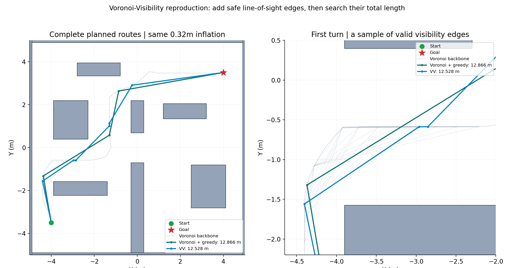

# 机器人避障课设：已有 VV 算法的复现与 Voronoi 路径改进

## 1. 采用哪项已有工作

本课设采用 **Voronoi–Visibility（VV）** 作为 Voronoi 的改进方案，复现以下工作：

Hanlin Niu, Al Savvaris, Antonios Tsourdos, Ze Ji. *Voronoi-Visibility Roadmap-based Path Planning Algorithm for Unmanned Surface Vehicles*. The Journal of Navigation, 72(4): 850–874, 2019. [DOI: 10.1017/S0373463318001005](https://doi.org/10.1017/S0373463318001005) · [公开全文](https://orca.cardiff.ac.uk/id/eprint/118170/1/Voronoi-Visibility%20Roadmap-based%20Path%20Planning%20Algorithm%20for%20Unmanned%20Su.._.pdf)。

论文方法在仓库膨胀栅格上用 Python 实现，核心是第 4.5 节的可见图构造和第 4.6 节的第二次 Dijkstra 搜索。课设工作包括算法复现、差速机器人接入、统一地图和对比实验。

## 2. Motivation：原 Voronoi 有什么可改进的地方

Voronoi 骨架使路线保持在自由空间中部，但沿骨架行驶可能绕远。现有 baseline 已用贪心直线简化：从当前节点寻找能安全直达的最远后续节点，再继续处理剩余路线。

这种局部选择主要减少节点数，一次跳得最远并不意味着剩余总距离最短。VV 保留各个安全连接选择，统一比较整条路径的距离。因此，VV 的优化对象是总长度，最后的节点数可以多于贪心方案。

## 3. VV 的具体方法

1. **机器人配置空间。** 机器人半径 0.18 m，加上 0.14 m 规划余量，得到共同的 0.32 m 障碍膨胀半径。
2. **Voronoi 骨架路线。** 从已知静态障碍边界构图，过滤不可通行节点和连线，接入起终点，运行 Dijkstra 得到未经简化的 Voronoi 路径。
3. **可见图。** 对该路径上的所有节点对进行连线检查；安全直线在膨胀栅格中可通行时，加入双向边，以欧氏距离为权重。
4. **全局选边。** 再运行一次 Dijkstra，得到 VV 路径。
5. **机器人执行。** Voronoi 与 VV 交给同一个跟踪器执行，输入相同的当前位姿、速度和激光扫描。

可见边权定义为

\[
w_{ij}=\begin{cases}
\|p_i-p_j\|_2,&p_i p_j\text{ 在共同膨胀地图中可通行},\\
+\infty,&\text{否则}.
\end{cases}
\]

VV 搜索所有可见边组成的路线，而非逐点采用最远跳跃。baseline 的每一条贪心连线也属于这个图，因此在同一节点集合和碰撞约束下，VV 规划折线的长度不会大于贪心折线。

仓库 seed 0 的原始骨架路线有 146 个节点。baseline 简化为 5 个节点，VV 选择 8 个节点；路径质量由总距离评价。



## 4. 地图、感知与公共执行

地图大小 10 m × 10 m，起点 (-4,-3.5)，终点 (4,3.5)，包含七组货架、中央短通道和上方通道。装卸小车在 seed 0 的 t=12..58 s 占用中央通道，巡行小车沿上方出货区运动。两辆车的最高速度不超过 0.4 m/s，运动时序与算法及机器人位置无关。

物理地图由静态货架、墙和动态小车组成。激光点是这些物体表面的测量结果。机器人已知静态栅格，动态障碍由当前扫描感知；仿真器独立记录实际小车位置并检查碰撞。每 0.05 s 的几何检查验证小车与静态物体、小车之间不相交。

Voronoi、VV、A*、RRT* 共用路径跟踪器：使用约 0.64 m 前视点、方向比例控制、加速度与轮速限制以及基于扫描的制动。最大速度 0.45 m/s，角速度 1.5 rad/s，线加速度 0.8 m/s²，角加速度 3 rad/s²。动态小车进入路线时，该执行层减速或制动。

## 5. 五个 baseline

| 方法 | 实现与执行 |
| --- | --- |
| A* | 0.10 m 栅格、八邻域、禁止穿角、直线简化，统一跟踪器执行 |
| RRT* | 1800 次采样、0.4 m 步长、15% 目标采样率、父节点选择和重连，统一跟踪器执行 |
| Voronoi | 障碍边界约 0.12 m 采样、骨架图搜索和贪心直线简化，统一跟踪器执行 |
| APF | 目标引力系数 1.2、斥力系数 0.8、作用距离 1.2 m，直接输出速度 |
| DWA | 7×19 组速度候选、1.5 s 预测时域、0.15 s 预测步长，直接朝终点导航 |

APF 与 DWA 不调用全局路线规划。A*、RRT*、Voronoi 和 VV 不调用 DWA。

## 6. 实验与结果

正式二维实验为同一地图、五个时序 seed、六种方法，共 30 次。seed 0 无时间偏移，其余 seed 为 [-1,1] s 内预先采样的动作偏移；RRT* 同时固定对应采样序列。

二维后端使用 180 条射线的 360° 首交点扫描，最远 5 m，包含遮挡。控制周期 0.10 s，碰撞以 0.01 s 子步检查。机器人在 100 s 内进入终点 0.25 m 范围且此前无碰撞，计为到达；首次碰撞终止该次运行。

[summary.csv](../results/summary.csv)记录全部运行，[manifest.json](../results/manifest.json)记录范围与配置，[raw_runs.json.gz](../results/raw_runs.json.gz)保存完整机器人轨迹、障碍位置和初始路线。规划折线长度、实际执行行程、到达时间与初次规划开销分别统计。时间图将失败记为 100 s，表格中的成功平均时间按到达运行计算。

| 方法 | 到达次数 | 成功平均耗时 | 成功平均行程 | 碰撞 | 超时 |
| --- | --- | --- | --- | --- | --- |
| A* | 4/5 | 74.28 s | 11.570 m | 1 | 0 |
| RRT* | 4/5 | 74.80 s | 11.660 m | 1 | 0 |
| Voronoi | 5/5 | 29.10 s | 12.367 m | 0 | 0 |
| APF | 0/5 | — | — | 0 | 5 |
| DWA | 0/5 | — | — | 0 | 5 |
| VV | 5/5 | 28.64 s | 12.099 m | 0 | 0 |

Voronoi 与 VV 的规划折线分别为 12.8658 m、12.5277 m，VV 缩短 2.63%；执行平均行程缩短 2.17%，平均到达时间缩短 1.58%。两者使用同一个控制器，25 条 baseline 轨迹与替换前逐点一致。

本机五次平均初次规划开销分别为 Voronoi 64.6 ms、VV 376.5 ms，增加的计算用于建立节点对可见边并再次搜索。两者全部运行的最低实际净空分别为 0.127 m、0.111 m，规划膨胀半径均为 0.32 m。


Webots 原生仿真使用同一地图与 seed 0。四个 90° 雷达扇区、每扇区 90 条射线构成原生 360° 扫描；导航周期为 96 ms，Supervisor 每 32 ms 检查真实位姿的几何净空。每次运行有独立 ID，并核对方法名、地图摘要和两个控制器的新日志。

## 7. 复现与答辩

```bash
python -m pip install -r requirements.txt
python scripts/generate_worlds.py
python -m unittest discover -s tests -v
python evaluation/benchmark.py --seeds 0 1 2 3 4
python evaluation/plot_results.py --video
python evaluation/webots_benchmark.py
python evaluation/check_webots_smoke.py
```

答辩可按“Voronoi 骨架为什么绕远—贪心简化如何选边—VV 怎样保留所有安全可见连接—第二次搜索如何缩短总距离—同控制器下的实际结果”讲解。对着局部放大图，指出两条路线在货架拐角处选择了不同的连接即可。
