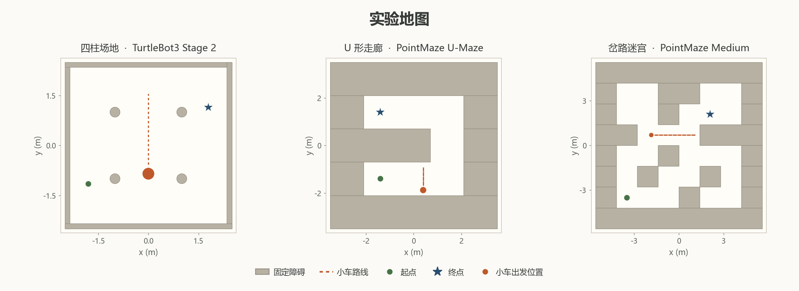
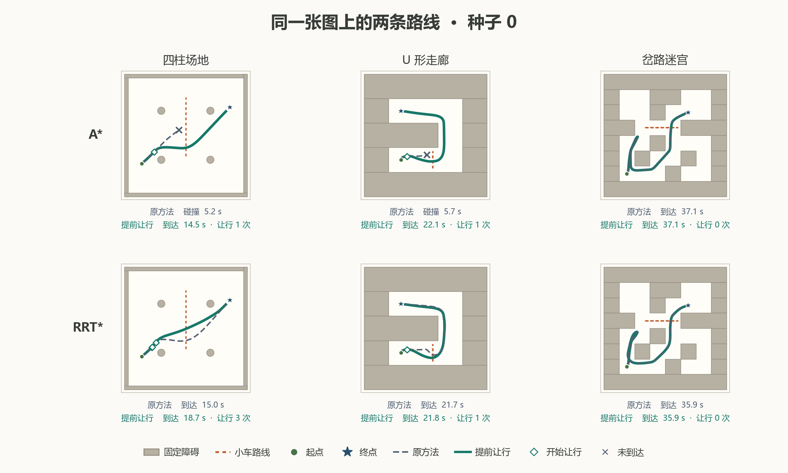

# 三张公开地图上的在线避障实验

四柱场地里，原版 A* 在 3.70 s 和 4.70 s 各找到一条新路线，5.19 s 仍撞上了横穿的小车。U 形走廊里，种子 1 的 RRT* 在 2.90 s 换了路线，接下来两次重规划都没找到路。在 5.23 s 碰撞时，机器人已经停住了。这两个例子提出了同一个问题。机器人能否在进入小车的行驶路线之前就决定让行？[两车同步回放](https://yandick.github.io/webots-path-planning-benchmark/)

## A* 和 RRT* 怎样提前让行

改进版沿用各自的搜索算法、采样种子和初始路线。机器人把连续几帧激光扫描放到地图上，滤掉墙和固定圆柱的回波，再把相邻的回波分成一组组障碍物。能看到足够长的圆弧时，估计小车中心和半径。点太少时，用可见表面估计。控制器根据最近 0.65 s 内的位置变化估计速度。超过 0.55 s 没有新观测，就丢弃该目标的记录。

每个控制步，机器人沿当前路线向前估计约 3.5 s，比较继续行驶和开始制动时，两车在各个时刻会相隔多远。可能相撞、停车位置又安全时，机器人提前减速。小车让出空间后再走。小车也可能在机器人已经进入路口时才起步。如果此时停下更容易被撞，机器人会继续穿过。遇到阻挡或让行后，若 2.5 s 内移动不足 0.10 m，控制器还会从实际停住的位置重新找路。[预测和让行](../navigation/yielding.py) · [重规划](../navigation/core.py)

在四柱场地的种子 0 中，改进版 A* 从 1.80 s 开始让行，5.60 s 恢复行驶，14.50 s 到达。在 U 形走廊的种子 1 中，改进版 RRT* 的让行区间是 1.60–6.50 s，22.40 s 到达。记录中的让行时间从发出减速指令开始，包括刹车过程。[逐次运行记录](../results/raw_runs.json.gz)

## 地图和任务

三张图各有一辆按固定时间行驶的小车。四柱场地保留了 TurtleBot3 的四根圆柱和方形围墙。U 形走廊和岔路迷宫采用 PointMaze 原有的墙格，每格 1.4 m。起终点和移动小车是本课设增加的。小车按预设路线行驶，所有算法在相同种子下面对相同的障碍。[布局原始文件和来源](../assets/maps/README.md)

| 地图 | 起点（m） | 终点（m） | 小车路线 |
| --- | --- | --- | --- |
| 四柱场地 | (−1.80, −1.15) | (1.80, 1.15) | 沿 x = 0 从南向北穿过场地中央，中途短暂停留 |
| U 形走廊 | (−1.40, −1.40) | (−1.40, 1.40) | 横过下方走廊，然后沿原路折返 |
| 岔路迷宫 | (−3.50, −3.50) | (2.10, 2.10) | 沿 y = 0.70 在岔路口东西往返 |

## 共同条件

主要对照是 A* 与 A* 提前让行版、RRT* 与 RRT* 提前让行版。每一对使用相同的初始路线、车速限制和路线跟踪器。Voronoi 与 G²VD Planner 使用同一个跟踪器，APF 和 DWA 各自决定局部运动，使用 A* 的引导路线。

机器人半径 0.18 m，规划时计入 0.14 m 余量。最大线速度 0.45 m/s，最大角速度 1.5 rad/s。每个控制步通过激光命中点标记障碍，通过测量射线清除旧的占据记录，观测最长保留 1 s。机器人到参考路线的连接段或剩余路线被堵住时才重新规划，两次尝试至少相隔 1 s。仿真器知道小车的位置，规划器使用静态地图、机器人位姿、速度和激光测量。[Nav2 障碍层](https://docs.nav2.org/jazzy/configuration_and_development/configuration_guide/core_servers/costmap_2d/costmap_plugins/obstacle/)

二维仿真的控制周期为 0.10 s，碰撞检查每 0.01 s 一次。激光用 180 条射线覆盖 360°，每束返回 5 m 范围内的首个命中点。100 s 内无碰撞进入距目标 0.25 m 的区域算到达。发生碰撞时立即结束，该次会保留在结果中。线加速度上限为 0.8 m/s²，角加速度上限为 3 rad/s²，轮距为 0.30 m。公共跟踪器按 0.08 m 间隔采样路线，向前看最多 8 个采样点。

种子 0 使用表定时刻，其余四个种子对小车的中间路标时刻统一施加不超过 0.6 s 的偏移。起终点、墙体和机器人参数固定。RRT* 的采样也使用对应种子。

## 搜索算法和参考方法

- **A\*** 在 0.10 m 栅格上搜索八邻域，检查穿角和线段碰撞，再简化路线。[Hart、Nilsson 与 Raphael](https://doi.org/10.1109/TSSC.1968.300136)
- **RRT\*** 每次规划最多采样 1800 次，步长 0.4 m，目标采样率 15%。通过重新选择父节点和重连改善树中的路线。[Karaman 与 Frazzoli](https://arxiv.org/abs/1105.1186)
- **Voronoi** 从障碍边界采样，构造 Voronoi 图，保留可以安全通过的边，接入起终点后搜索路线并在可直行处简化。[实现](../navigation/classical.py)
- **G²VD Planner** 是 Wen 等人的论文方法。项目复现第 IV-D 节的二次规划平滑，前段使用本项目的几何 Voronoi 参考路线。平滑和偏离参考线的权重为 1000 和 1。三次样条以 0.04 m 间隔离散并检查碰撞。配置名为 `voronoi_qp`。[原论文](https://arxiv.org/abs/2201.12981) · [实现](../navigation/smoothing.py)
- **APF** 吸引力指向 A* 路线的前视点，最近的激光障碍点产生斥力。吸引系数为 2，阻尼为 2，斥力系数为 0.008，作用范围为 0.50 m。[Khatib](https://doi.org/10.1177/027836498600500106)
- **DWA** 在可达速度窗内取 7 组线速度、31 组角速度，预测 1.7 s。对圆弧作碰撞和制动检查，再按朝向、障碍距离和速度打分，权重分别为 0.60、0.25 和 0.15。[Fox、Burgard 与 Thrun](https://publications.ri.cmu.edu/storage/publications/pub_files/pub1/fox_dieter_1997_1/fox_dieter_1997_1.pdf)

平滑优化最小化参考点的二阶差分和偏移量。起终点固定，每个中间点使用正方形约束，半宽为 \(\max(0, d_i/\sqrt{2} - 0.32)\) m。这里的障碍距离已减去半个栅格对角线。代码使用 SciPy L-BFGS-B，并对输出线段逐条作通行检查。[约束与插值](../navigation/smoothing.py)

## 二维仿真结果

三张图、五个种子，共 120 次。在相同的 15 个条件下，A* 原版 7 次到达、7 次碰撞、1 次超时。RRT* 原版 10 次到达、2 次碰撞、3 次超时。两种改进版分别 15 次到达。岔路迷宫种子 2 和 3 中，原版 RRT* 卡到超时。两次改进版都没有发出让行指令，靠从停住的位置重算路线脱困。[逐次数据](../results/summary.csv)

只在两版都到达的种子上比较耗时。四柱场地有四组 RRT* 可以配对，改进版平均多用 1.80 s。U 形走廊有三组，改进版平均少用 0.63 s。四柱场地的 A* 只有种子 4 可以配对，原版用时 10.70 s，改进版用时 15.70 s。[逐条轨迹和重规划记录](../results/raw_runs.json.gz)

下表每行有五次运行。耗时和行程只对到达的运行取平均。最后一列先取每次运行中车身边缘到所有障碍的最小距离，再对五次取平均。

| 地图 | 方法 | 到达 | 碰撞 | 超时 | 到达平均耗时（s） | 到达平均行程（m） | 与障碍物的最小距离均值（m） |
| --- | --- | ---: | ---: | ---: | ---: | ---: | ---: |
| 四柱场地 | A* | 1/5 | 3 | 1 | 10.70 | 4.21 | 0.020 |
| 四柱场地 | A*（提前让行） | 5/5 | 0 | 0 | 14.64 | 4.28 | 0.102 |
| 四柱场地 | RRT* | 4/5 | 0 | 1 | 14.70 | 4.34 | 0.093 |
| 四柱场地 | RRT*（提前让行） | 5/5 | 0 | 0 | 16.42 | 4.28 | 0.102 |
| 四柱场地 | Voronoi | 5/5 | 0 | 0 | 11.88 | 4.70 | 0.124 |
| 四柱场地 | APF controller | 5/5 | 0 | 0 | 16.36 | 5.43 | 0.135 |
| 四柱场地 | DWA controller | 4/5 | 0 | 1 | 22.85 | 4.84 | 0.089 |
| 四柱场地 | G²VD Planner | 4/5 | 1 | 0 | 17.53 | 6.73 | 0.228 |
| U 形走廊 | A* | 1/5 | 4 | 0 | 22.50 | 7.48 | 0.008 |
| U 形走廊 | A*（提前让行） | 5/5 | 0 | 0 | 22.10 | 7.01 | 0.152 |
| U 形走廊 | RRT* | 3/5 | 2 | 0 | 22.37 | 7.29 | 0.021 |
| U 形走廊 | RRT*（提前让行） | 5/5 | 0 | 0 | 22.04 | 7.00 | 0.148 |
| U 形走廊 | Voronoi | 4/5 | 1 | 0 | 39.93 | 6.99 | 0.008 |
| U 形走廊 | APF controller | 5/5 | 0 | 0 | 23.74 | 8.48 | 0.119 |
| U 形走廊 | DWA controller | 4/5 | 1 | 0 | 34.53 | 7.12 | 0.120 |
| U 形走廊 | G²VD Planner | 5/5 | 0 | 0 | 21.14 | 7.43 | 0.126 |
| 岔路迷宫 | A* | 5/5 | 0 | 0 | 36.34 | 14.75 | 0.110 |
| 岔路迷宫 | A*（提前让行） | 5/5 | 0 | 0 | 36.48 | 14.75 | 0.110 |
| 岔路迷宫 | RRT* | 3/5 | 0 | 2 | 27.97 | 11.48 | 0.116 |
| 岔路迷宫 | RRT*（提前让行） | 5/5 | 0 | 0 | 28.28 | 10.54 | 0.116 |
| 岔路迷宫 | Voronoi | 0/5 | 0 | 5 | — | — | 0.102 |
| 岔路迷宫 | APF controller | 5/5 | 0 | 0 | 46.32 | 16.78 | 0.099 |
| 岔路迷宫 | DWA controller | 4/5 | 0 | 1 | 62.62 | 14.21 | 0.099 |
| 岔路迷宫 | G²VD Planner | 5/5 | 0 | 0 | 26.54 | 10.13 | 0.125 |

## Webots 原生验证

Webots R2025a 在每张图上用种子 0 运行八种方法，共 24 次。四个 90° 扇区提供原生激光点云，控制器每 96 ms 更新一次，监督器每 32 ms 读取位置并检查碰撞。四柱场地的原版 A* 在 9.376 s 碰撞，改进版在 1.824 s 开始让行，14.784 s 到达。原版 RRT* 在这三张图的种子 0 都能到达。改进版在四柱场地多用 2.816 s，在岔路迷宫用时相同。[原生验证摘要](../results/webots_validation.json) · [完整原生日志](../results/webots_raw_runs.json.gz)

| 方法 | 四柱场地 | U 形走廊 | 岔路迷宫 |
| --- | --- | --- | --- |
| A* | 碰撞 · 9.38 s | 到达 · 23.23 s | 到达 · 37.34 s |
| A*（提前让行） | 到达 · 14.78 s | 到达 · 23.58 s | 到达 · 37.34 s |
| RRT* | 到达 · 15.20 s | 到达 · 22.82 s | 到达 · 35.97 s |
| RRT*（提前让行） | 到达 · 18.02 s | 到达 · 23.71 s | 到达 · 35.97 s |
| Voronoi | 到达 · 11.71 s | 到达 · 40.19 s | 超时 · 100.00 s |
| APF controller | 到达 · 17.73 s | 到达 · 26.56 s | 到达 · 52.22 s |
| DWA controller | 到达 · 35.10 s | 到达 · 33.34 s | 超时 · 100.00 s |
| G²VD Planner | 到达 · 31.20 s | 到达 · 21.44 s | 到达 · 53.44 s |

这组测试覆盖每张地图上一辆慢速小车。短时预测假设小车大致保持刚才观测到的速度，路口有遮挡、来车急转弯或多车交错时的表现还需要单独实验。

## 附录 · G²VD Planner 的平滑对照

每张图另跑一次种子 0，对同一 Voronoi 参考路线关闭 QP 和样条。下表先列启用平滑的结果，斜线后是关闭平滑的结果。初始路线峰值曲率按 0.10 m 弧长采样估计。角加速度 RMS 只计线速度绝对值超过 0.02 m/s 的样本。[三次未平滑运行](../results/smoothing_ablation.json.gz)

| 地图 | 到达用时（s） | 与障碍物的最小距离（m） | 初始路线峰值曲率（m⁻¹） | 运动中角加速度 RMS（rad/s²） |
| --- | ---: | ---: | ---: | ---: |
| 四柱场地 | 18.00 / 17.00 | 0.285 / 0.316 | 1.266 / 8.033 | 0.953 / 1.083 |
| U 形走廊 | 21.30 / 21.70 | 0.131 / 0.118 | 1.293 / 8.255 | 0.695 / 0.668 |
| 岔路迷宫 | 26.60 / 26.90 | 0.126 / 0.159 | 1.176 / 9.901 | 0.759 / 1.033 |

[运行实验](../README.md#本地运行) · [构建主页](website.md)
