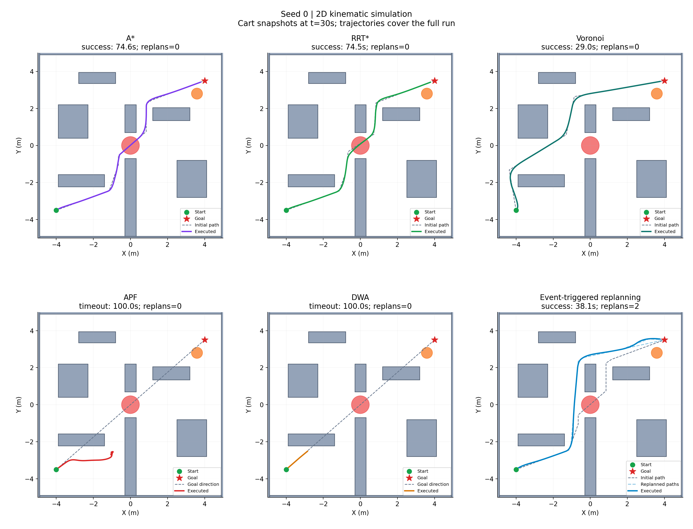

# 机器人避障课设：一张仓库地图上的事件触发重规划

## 地图与感知为什么这样设计

地图和传感器分属两个层次。地图中的实体是货架、墙体和小车；激光点是机器人测得的这些实体的表面位置，不是额外摆放的点状障碍。

本项目采用“已知静态地图＋激光障碍观测＋安全膨胀”的结构。[Nav2 官方示例](https://github.com/ros-navigation/navigation2/blob/main/nav2_bringup/params/nav2_params.yaml)包含 StaticLayer、接收 LaserScan 的 ObstacleLayer 和 InflationLayer；[Webots 原生 Lidar](https://github.com/cyberbotics/webots/blob/R2025a/docs/reference/lidar.md)提供距离图与点云接口。

静态栅格由已知几何构建，动态障碍通过传感器观测。仿真器根据预设时间表移动小车，并独立检查碰撞。原生控制器通过 GPS/IMU 获取位姿，通过激光雷达获取障碍观测。

## 唯一地图的任务

世界大小 10 m × 10 m，起点 (-4,-3.5)，终点 (4,3.5)，任务预算 100 s。七组货架安排为交错进出通道、中央短通道和上方绕行通道，初始 A* 路径需要连续转弯，起终点无法直线相连。

- 装卸小车：从右侧作业区域进入中央通道。seed 0 在 t=12..58 s 停留，然后退出。半径 0.48 m，通道宽 1.4 m，机器人直径 0.36 m，无法从车旁挤过去；上方仍有实际可行的替代路线。
- 巡行小车：沿上方出货通道运动，迫使机器人在绕行后继续处理移动障碍。其速度与路线不随机器人或方法改变。

小车最高速度不超过 0.4 m/s。seed 0 无偏移，其余 seed 的动作时间整体增加 [-1,1] s 中预先采样的偏移。每个方法使用同一时间表。几何验证每 0.05 s 检查小车与静态物体、小车之间是否相交。运动物体有实际 boundingObject，不会穿墙或在接近机器人时主动消失。

小车采用固定运输作业的预设轨迹，具备可视几何和碰撞几何。


## Baseline 的局限与改进动机

固定 A* 路径只知道初始静态地图。DWA 可以短时减速、转弯，但仍追踪同一条全局路线。当短通道被持续占用时，局部避障无法主动选择另一条通路。

只在机器人完全停住后再重规划也可能太晚：机器人已深入狭窄区域，转向和退让空间减少。因此，改进方法同时检查“前方参考路径是否持续被新障碍占用”和“机器人是否已经停滞”。前者提前换路，后者作为补充触发。

改进内容是根据前方占用与停滞状态更新全局路径，使机器人及时选择可通行路线。

## 五个单算法 baseline

| 方法 | 输入 | 输出与执行 |
| --- | --- | --- |
| A* | 静态栅格、起终点 | 搜索路线，由统一路径跟踪器执行 |
| RRT* | 静态地图、起终点、采样 seed | 随机树采样、选择父节点和重连，路线交给同一跟踪器 |
| Voronoi | 静态障碍边界、起终点 | 构造自由空间骨架并搜索路线，交给同一跟踪器 |
| APF | 目标位置、当前扫描 | 合成引力与斥力，直接输出线速度和角速度 |
| DWA | 目标位置、当前扫描、当前速度 | 模拟候选速度轨迹并选择控制指令 |

A*、RRT*、Voronoi 均在启动时规划一次。统一跟踪器根据前视点做方向控制，遇障时制动，在障碍离开后继续沿原路线行驶；该跟踪器不执行 DWA 搜索，也不重规划。

RRT* 使用 1800 次采样、0.4 m 扩展步长、15% 目标采样概率，并在重连时更新后代代价。Voronoi 以约 0.12 m 间距采样障碍边界，保留满足膨胀距离的骨架边，经 Dijkstra 搜索连接起终点。三种全局算法都对路径做碰撞检查后的直线简化。

APF 的目标引力系数为 1.2，斥力系数为 0.8，作用距离为 1.2 m，按扫描角密度归一化累积斥力，并映射成差速底盘速度。DWA 直接以终点作为目标，不预先调用 A* 或其他全局算法。

## 机器人与改进方法的公共参数

A* 使用 0.10 m 栅格、八邻域搜索、禁止对角穿角和碰撞检查后的直线简化。静态规划膨胀半径为 0.18 m 机器人半径＋0.14 m 安全余量。

DWA 使用 7×19 组速度候选、1.5 s 预测时域和 0.15 s 预测步长。所有方法最大线速度均为 0.45 m/s，角速度为 1.5 rad/s，加速度与轮速均受限制。DWA 评分包含目标距离、方向误差、速度、安全距离与角速度变化，行进候选满足身体安全余量与制动距离要求。

公共跟踪器修复了两处一致性问题：前视点连线使用规划时的膨胀半径；重新规划后，跟踪器使用新路径对应的障碍地图，防止前视点又跨过刚刚避开的物体。圆形机器人静止时允许在保持物理净空的前提下原地转向，平移仍要求完整安全余量。

恒速预测用于 DWA 轨迹检查：把偏离已知静态边界的激光点聚类，匹配相邻扫描的表面质心，对位移估计作低通平滑，并向前外推到 DWA 时域。静态点保持原位置，候选同时检查当前与预测障碍点。


## 事件触发重规划的具体步骤

1. 将当前扫描变换到世界坐标。与已知静态边界距离大于 0.12 m 的点作为额外障碍观测，合并到 0.15 m 单元的短时记忆中。
2. 每个观测保存 4 s，重复看到则更新时间。临时障碍用小圆离散后加入规划地图并膨胀。当前版本使用超时遗忘，没有实现 Nav2 完整的射线清除机制。
3. 检查当前路径前方 1.8 m：若观测点距路径小于约 0.32 m，并持续 0.8 s，认为路线受阻。同时保留 2.5 s 窗口内净移动小于 0.18 m 的停滞触发。
4. 满足触发、存在额外障碍观测，且距上次尝试至少 4 s 时，在更新地图上重新运行 A*。
5. 找到新路径就切换路线与对应地图；找不到则保留原路径并记录失败尝试。当前安全位置若已进入新障碍的膨胀带，允许寻找 0.8 m 范围内、按真实机器人尺寸检查的短退出路径，不能删除占据单元。

改进方法以 A* 路线为参考，使用 DWA 执行，并按上述事件更新路线。五个 baseline 分别按各自的单算法运行。

## 实验设置与结果

正式二维实验为 1 张地图 × 5 个时序偏移 × 6 种方法，共 30 次；其中五种为 baseline，一种为改进方法。RRT* 同时使用对应 seed 固定采样序列。所有运行记录在 [summary.csv](../results/summary.csv)，[manifest.json](../results/manifest.json)声明范围和配置，[raw_runs.json.gz](../results/raw_runs.json.gz)保留完整轨迹。

| 方法 | 无碰撞到达 | 成功运行平均时间 | 碰撞 | 超时 |
| --- | --- | --- | --- | --- |
| A* | 4/5 | 74.28 s | 1 | 0 |
| RRT* | 4/5 | 74.80 s | 1 | 0 |
| Voronoi | 5/5 | 29.10 s | 0 | 0 |
| APF | 0/5 | — | 0 | 5 |
| DWA | 0/5 | — | 0 | 5 |
| 事件触发改进 | 5/5 | 38.82 s | 0 | 0 |

Voronoi 的初始路线走上方通道，避开了中央装卸区域，在这张图上最快。A* 和 RRT* 选择中央短通道，主要耗时在等待小车离开；seed 4 中，两者在小车进入通道时发生碰撞。改进方法在 seed 0 的 t=11.3 s 切换上方路线，在 t=31.8 s 再调整末段路线，五次均到达。

改进方法的平均实际行程为 12.508 m，Voronoi 为 12.367 m；五次运行中的最低表面净空分别为 0.117 m、0.127 m。APF、DWA 的超时轨迹也完整保存在压缩包中。

二维后端是圆形差速机器人的运动学模型，180 条射线构成 360°、最远 5 m 的首交点扫描，考虑遮挡。控制周期 0.10 s，碰撞以 0.01 s 子步检查。进入目标 0.25 m 范围且此前无碰撞才算成功；首次碰撞即终止。净空是机器人表面到障碍物表面的距离。




统计包括全部时序偏移，时间图对失败采用 100 s 任务预算惩罚，原始 CSV 保留实际终止时间。

Webots 使用同一几何与时序，四个 90° 雷达扇区组成原生 360° 扫描，控制与传感器更新周期为 96 ms。独立 Supervisor 每 32 ms 以真实位姿检查几何碰撞；每次运行要求独立 ID、正确场景摘要，并同时获得两个控制器的新日志。CI 还核对原生激光点与实际障碍边界。

原生结果由 CI 运行与完整轨迹记录。

## 复现与答辩

```bash
python -m pip install -r requirements.txt
python scripts/generate_worlds.py
python -m unittest discover -s tests -v
python evaluation/benchmark.py --seeds 0 1 2 3 4
python evaluation/plot_results.py --video
python evaluation/webots_benchmark.py
python evaluation/check_webots_smoke.py
```

建议按“仓库任务—固定路径停等—持续占用触发—切换通道—到达时间与代价—局限”展示。动画中的红色、橙色小车在各面板使用同一时钟，不能给不同方法播放不同相位。

基础模块的依赖关系是 `grid_map → scenarios → tracking/core → simulation 或 Webots 适配`；世界文件由同一 scenarios 加独立 robot 模板生成。旧算法、旧世界和旧结果已从当前树删除，历史来源保留在 Git 历史中。当前图表只读取当前完整轨迹压缩包，不混用旧日志。

基础方法出处：Fox, Burgard, Thrun, *The Dynamic Window Approach to Collision Avoidance*, 1997，[原论文](https://publications.ri.cmu.edu/storage/publications/pub_files/pub1/fox_dieter_1997_1/fox_dieter_1997_1.pdf)。
